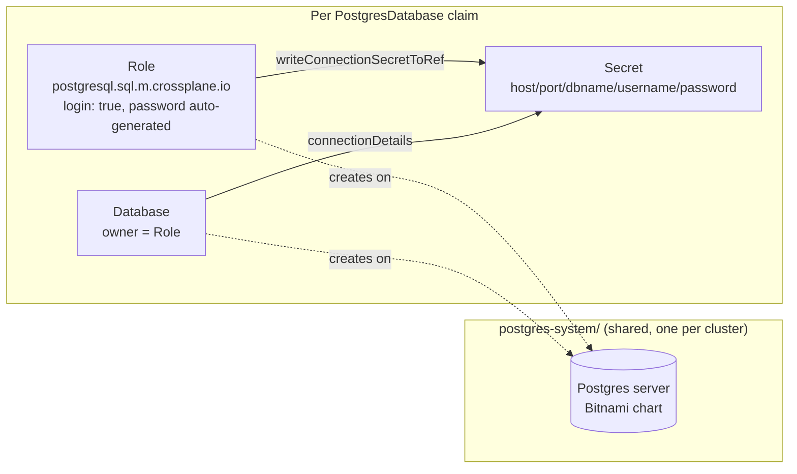

# `PostgresDatabase`

Self-service logical Postgres database. Defined in [`compositions/postgres-database/`](../../compositions/postgres-database/).

```yaml
apiVersion: database.idplatformkit.io/v1alpha1
kind: PostgresDatabase
metadata:
  name: demo-app        # the role and database on the server are named <namespace>_<name>: default_demo-app
  namespace: default
spec:
  writeConnectionSecretToRef:
    name: demo-app-db-conn
```

`ownerGroup`/RBAC-style parameters aren't needed here — this XRD's schema has exactly one required field, `writeConnectionSecretToRef.name`. Everything else is derived from `metadata.namespace` and `metadata.name`.

## Architecture



- **Shared server, not one-per-claim.** `platform/postgres-server/` installs *one* Postgres server for the whole cluster. `provider-sql` then manages logical `Database`/`Role` objects on it per claim — much cheaper than a full Postgres instance per database, matching the "shared server, per-tenant logical partition" pattern used throughout this repo.
- **`Role` owns `Database`.** The `Database`'s `forProvider.owner` is set to the role's server-side name, so the role gets full rights on everything it creates in that database without a separate `Grant` resource.
- **Password never touches the Composition.** `provider-sql`'s `Role` auto-generates its password and writes it straight to a connection secret (`writeConnectionSecretToRef`) — the Composition only reads `username`/`password` back out via `connectionDetails: [{type: FromConnectionSecretKey, ...}]` to fold them into the claim's own aggregated secret alongside `host`/`port`/`dbname`.
- **Crossplane v2 has no built-in XR connection-secret aggregation** (a v1 feature that was dropped). The `writeConnectionSecretToRef` block at the top of the Composition's pipeline input is what recreates it: it patches the XR's `spec.writeConnectionSecretToRef.name` into the function's own aggregation target.

## Server-side names: `<namespace>_<name>` (a security fix)

All tenants share one Postgres server, so the names of roles and databases on it must be unique across namespaces. The first version named both after the XR's `metadata.name` only. That had a real consequence, reproduced on kind with two throwaway namespaces ([#21](https://github.com/idPlatformKit/Orchestrator/issues/21)):

1. `pg-victim/shared-name` was created, and data was written into database `shared-name`.
2. `pg-attacker/shared-name` **also became `Ready`**: its `Role` and `Database` adopted the existing role and database. Its connection Secret had no username or password, so no credentials leaked.
3. Deleting `pg-attacker/shared-name` **dropped the victim's database and role** on the server. The victim's XR still reported `Ready` a minute later.

So any team could destroy another team's database just by knowing its name.

The role and database are now named `<namespace>_<name>`, through the managed resources' `crossplane.io/external-name` annotation. Kubernetes names can't contain `_`, so two `(namespace, name)` pairs never produce the same identifier, and a team can only create resources in its own namespace. The same scenario after the fix created `pg-victim_shared-name` and `pg-attacker_shared-name`, and deleting the attacker's left the victim's data intact. The connection Secret's `dbname` and `username` carry the new names.

Postgres truncates identifiers longer than 63 bytes. Keep `<namespace>_<name>` under that length.

**Migrating existing databases.** Changing the external name doesn't rename anything on the server: Crossplane created a **new** role and database under the new name, updated the connection Secret, and left the old ones in place, unmanaged. For `checkout/checkout-db`, `checkout_checkout-db` was created (login with the new Secret verified), and the orphaned `checkout-db` database, which had no tables, and its role were dropped by hand:

```sh
kubectl exec -n postgres-system postgres-server-postgresql-0 -- \
  env PGPASSWORD=postgres-local-dev psql -U postgres \
  -c 'DROP DATABASE "checkout-db";' -c 'DROP ROLE "checkout-db";'
```

That's acceptable for a dev-mode reference setup with demo data only. On a platform holding real data, migrating would mean copying each database to its new name before dropping the old one.

## Try it

```sh
make local-up
make try-postgres-database   # applies examples/postgres-database.yaml, prints the connection secret
```

Verified end-to-end (not just `Ready`): the generated credentials were used to run an actual `psql` session against the shared server — connect, `CREATE TABLE`, `INSERT`, `SELECT` all succeeded as the auto-provisioned role.
