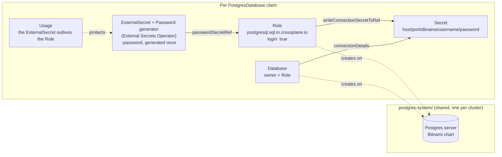

# `PostgresDatabase`

Self-service logical Postgres database. Defined in [`compositions/postgres-database/`](../../compositions/postgres-database/).

```yaml
apiVersion: database.idplatformkit.io/v1alpha1
kind: PostgresDatabase
metadata:
  name: demo-app        # the role and database on the server are named <namespace>_<name>: default_demo-app
  namespace: default
spec:
  writeConnectionSecretToRef:
    name: demo-app-db-conn
  deletionPolicy: Retain   # the default: deleting this object keeps the database
```

`ownerGroup`/RBAC-style parameters aren't needed here — this XRD's schema has exactly one required field, `writeConnectionSecretToRef.name`. Everything else is derived from `metadata.namespace` and `metadata.name`. `deletionPolicy` is described [below](#deleting-keeps-the-database-deletionpolicy).

## Architecture



- **Shared server, not one-per-claim.** `platform/postgres-server/` installs *one* Postgres server for the whole cluster. `provider-sql` then manages logical `Database`/`Role` objects on it per claim — much cheaper than a full Postgres instance per database, matching the "shared server, per-tenant logical partition" pattern used throughout this repo.
- **`Role` owns `Database`.** The `Database`'s `forProvider.owner` is set to the role's server-side name, so the role gets full rights on everything it creates in that database without a separate `Grant` resource.
- **Password never touches the Composition.** External Secrets Operator's `Password` generator creates it once (32 letters and digits, `refreshPolicy: CreatedOnce`) in the Secret `<name>-password`, which the `Role` reads through `passwordSecretRef`. `provider-sql` sets it on the role and writes it to the role's connection secret (`writeConnectionSecretToRef`); the Composition only reads `username`/`password` back out via `connectionDetails: [{type: FromConnectionSecretKey, ...}]` to fold them into the claim's own aggregated secret alongside `host`/`port`/`dbname`. Until #24, `provider-sql` generated the password itself; why that changed is [below](#an-adopted-role-lost-its-password).
- **Crossplane v2 has no built-in XR connection-secret aggregation** (a v1 feature that was dropped). The `writeConnectionSecretToRef` block at the top of the Composition's pipeline input is what recreates it: it patches the XR's `spec.writeConnectionSecretToRef.name` into the function's own aggregation target.

## Server-side names: `<namespace>_<name>` (a security fix)

All tenants share one Postgres server, so the names of roles and databases on it must be unique across namespaces. The first version named both after the XR's `metadata.name` only. That had a real consequence, reproduced on kind with two throwaway namespaces ([#21](https://github.com/idPlatformKit/Orchestrator/issues/21)):

1. `pg-victim/shared-name` was created, and data was written into database `shared-name`.
2. `pg-attacker/shared-name` **also became `Ready`**: its `Role` and `Database` adopted the existing role and database. Its connection Secret had no username or password, so no credentials leaked.
3. Deleting `pg-attacker/shared-name` **dropped the victim's database and role** on the server. The victim's XR still reported `Ready` a minute later.

So any team could destroy another team's database just by knowing its name.

The role and database are now named `<namespace>_<name>`, through the managed resources' `crossplane.io/external-name` annotation. Kubernetes names can't contain `_`, so two `(namespace, name)` pairs never produce the same identifier, and a team can only create resources in its own namespace. The same scenario after the fix created `pg-victim_shared-name` and `pg-attacker_shared-name`, and deleting the attacker's left the victim's data intact. The connection Secret's `dbname` and `username` carry the new names.

Postgres truncates identifiers longer than 63 bytes. Keep `<namespace>_<name>` under that length.

**Migrating existing databases.** Changing the external name doesn't rename anything on the server: Crossplane created a **new** role and database under the new name, updated the connection Secret, and left the old ones in place, unmanaged. For `checkout/checkout-db`, `checkout_checkout-db` was created (login with the new Secret verified), and the orphaned `checkout-db` database, which had no tables, and its role were dropped by hand:

```sh
kubectl exec -n postgres-system postgres-server-postgresql-0 -- \
  env PGPASSWORD=postgres-local-dev psql -U postgres \
  -c 'DROP DATABASE "checkout-db";' -c 'DROP ROLE "checkout-db";'
```

That's acceptable for a dev-mode reference setup with demo data only. On a platform holding real data, migrating would mean copying each database to its new name before dropping the old one.

## Deleting keeps the database (`deletionPolicy`)

Deleting a `PostgresDatabase`, by itself, with its namespace (its tenant, or one of its environments, removed) or with the [`App`](app.md) that composed it, **keeps the database and its role in Postgres**, with their data. That's `deletionPolicy: Retain`, the default. A file removed from the instances repository, and Argo CD's pruning, can't drop data.

| `deletionPolicy` | Management policies of the `Database` and `Role` objects | Deleting the `PostgresDatabase` |
|---|---|---|
| `Retain` (default) | `Observe, Create, Update, LateInitialize` | keeps the database and the role on the server, unmanaged |
| `Delete` | `*` | drops them |

- **Re-creating** a `PostgresDatabase` with the same name in the same namespace adopts the database again, with its data: the server-side name is `<namespace>_<name>`, so it's the same one.
- **To drop the database**, set `deletionPolicy: Delete` first, wait until `status.databaseManagementPolicies` is `["*"]` (the `Database` object got it), then delete. Deleted earlier, it's only orphaned. An `App` does this for the services confirmed in its annotation ([app.md](app.md#protecting-the-data)).
- **Retained databases** are left for a person to drop by hand, for example after a tenant was removed on purpose.

**Retain also avoids the [#14](https://github.com/idPlatformKit/Orchestrator/issues/14) hang.** Without `Delete`, Crossplane removes the object's finalizer without connecting to Postgres. A namespace holding a retained `Database` was deleted in 11 seconds, and the database stayed. With `Delete`, deleting the namespace (instead of the `PostgresDatabase` first) still hangs as in #14: the object can't connect from a terminating namespace, and the database isn't dropped.

What was checked on kind:

- A `Database` object without `Delete`: its namespace deleted in 11 seconds, the database still on the server; re-created under the same name, it adopted it again, and a row written before was still there.
- An `App`'s database kept through the deletion of its tenant, then adopted again when the tenant and the `App` were re-created: the app reached it, and a row written before was still there (`make try-app-protection`).
- Setting `Delete` on it: `status.databaseManagementPolicies` became `["*"]` within 4 seconds.

### An adopted role lost its password

The first version of the retention kept `provider-sql`'s generated password. Deleting a tenant, then re-creating it with the same `App`, adopted the database and its role, but the new connection Secret had no `password` key, and the pods stayed in `CreateContainerConfigError` (`couldn't find key password in Secret`). `provider-sql` v0.16.1 sets a new password on a role whose connection secret has none, from its first update. That update ran the `ALTER ROLE ... PASSWORD`, recorded `lastPasswordChange` in the status, then failed on `cannot compare desired and observed privileges` before publishing the password. The next updates saw `lastPasswordChange` and didn't rotate again: the password was lost. One earlier attempt, outside a namespace deletion, had worked by luck: its first update didn't fail.

With an explicit password, `provider-sql` compares it to the one it published on every reconcile and sets it again when they differ. Giving the stuck role a `passwordSecretRef` by hand fixed it in 6 seconds, and the app read its database, data included. Hence the generated `<name>-password` Secret.

**Then deletions got stuck.** The role reads its password Secret on every reconcile, deletion included. Deleting a `PostgresDatabase` deleted the `ExternalSecret` (and the Secret it owns) at the same time as the role, and the role stayed stuck on `observe failed: cannot get password secret: Secret "hello-db-password" not found`. A Crossplane `Usage` (`protection.crossplane.io/v1beta1`) of the `ExternalSecret` by the role now makes Crossplane refuse to delete the `ExternalSecret` while the role exists, and delete it right after (`replayDeletion`).

**Upgrading** to this version changes the password of every existing database once: the generated one replaces `provider-sql`'s. Running pods keep the old one in their environment until they restart. Existing `PostgresDatabase`s pick up the new composition at their next reconcile; on the test installation they didn't within 4 minutes after the upgrade (changing the XRD restarts their controller, and nothing else changed), and touching them (any annotation) applied it.

## Portal view: the `idplatformkit.io/tenant` label

The `Role` and `Database` carry `idplatformkit.io/tenant: <namespace>`, set by the Composition from the XR's actual namespace. The portal's entity for a database selects its objects with `crossplane.io/composite=<name>,idplatformkit.io/tenant=<namespace>`. `crossplane.io/composite` alone isn't enough, because two tenants can each have a database with the same name.

Claims opened by the portal's New Postgres database template put the same label on the `PostgresDatabase` itself, so it shows up too. The composition can't label its own XR.

Using `backstage.io/kubernetes-namespace` instead looked simpler, but a namespaced lookup also queries the cluster-scoped kinds the portal knows about, such as `Tenant`. It then reports a `NOT_FOUND` error in the Kubernetes tab.

## Try it

```sh
make local-up
make try-postgres-database   # applies examples/postgres-database.yaml, prints the connection secret
```

Verified end-to-end (not just `Ready`): the generated credentials were used to run an actual `psql` session against the shared server — connect, `CREATE TABLE`, `INSERT`, `SELECT` all succeeded as the auto-provisioned role.
