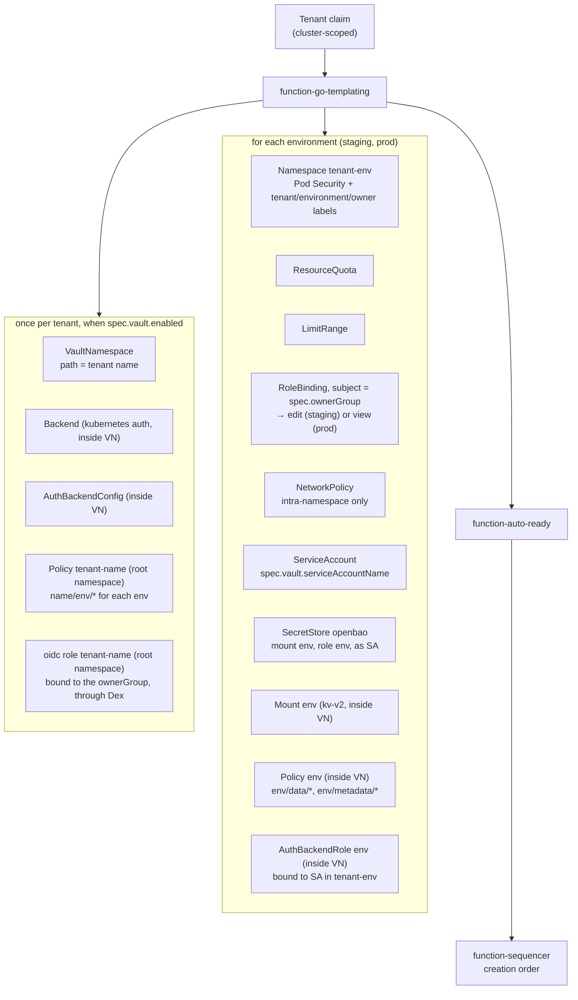

# `Tenant`

Self-service team space: one namespace baseline per environment, with an optional per-tenant OpenBao secrets space. Defined in [`compositions/tenant/`](../../compositions/tenant/).

```yaml
apiVersion: platform.idplatformkit.io/v1alpha1
kind: Tenant
metadata:
  name: demo-team   # the namespaces are demo-team-staging and demo-team-prod; also the OpenBao namespace path
spec:
  ownerGroup: demo-team-engineers
  environments: [staging, prod]    # the default
  vault:
    enabled: true
    serviceAccountName: demo-app   # in each environment, the *only* ServiceAccount allowed to read its secrets
```

`Tenant` is `scope: Cluster` (unlike `PostgresDatabase`): it mints *new* namespaces, so it can't itself live inside one. Every composed namespaced resource therefore gets an explicit `metadata.namespace` rather than inheriting the XR's own namespace.

What each environment changes (Pod Security level, the team's rights, prod's extra rules) is described in [environments.md](../environments.md).

## Architecture



The baseline (`Namespace`, `ResourceQuota`, `LimitRange`, `RoleBinding`, `NetworkPolicy`) is created in every environment of `spec.environments`. The OpenBao resources, the ServiceAccounts and the SecretStores are only composed when `spec.vault.enabled` is true: one Composition serves both "just namespaces" and "namespaces + secrets space" claims, with no second Composition and no per-capability XRD.

**Why a template.** The composition used to be a patch-and-transform pipeline, with `function-cel-filter` dropping the `vault-*` resources when the add-on was off. Patch-and-transform can't loop over a list, and environments need one set of resources per entry of `spec.environments`, so the composition is now a `function-go-templating` template; the add-on is an `if` in it. Every resource gets a fixed name (`namespace-staging`, `vault-mount-prod`, ...) that the sequencer's rules refer to.

**Where the OpenBao managed resources live.** In the platform's `idpk-tenants` namespace, not in the tenant's: teams have `edit` in staging and could otherwise change them, and deleting a namespace while managed resources are still in it hangs ([#14](https://github.com/idPlatformKit/Orchestrator/issues/14)). The ServiceAccounts and SecretStores live in each environment's namespace, where the workloads use them.

## Why OpenBao, not Vault

Vault Community Edition gates real **Namespaces** — a genuine per-tenant isolation boundary with its own policies, mounts and auth methods — behind Vault Enterprise. [OpenBao](https://openbao.org/), the Linux Foundation's open-source Vault fork, ships Namespaces free and GA in its community edition. That's the one feature this design actually needs, so the shared server is OpenBao (`platform/openbao-server/`, dev mode) rather than Vault, and `provider-vault` (Terraform-based, Vault-API-compatible, so it talks to OpenBao without modification) is pointed at it.

Each tenant gets its **own** `VaultNamespace`, with its **own** kv-v2 `Mount` and `Policy` per environment inside it (`staging/`, `prod/`): not a shared mount with per-tenant path prefixes. This was verified directly, not assumed: a secret written into one tenant's namespace is invisible both from the root namespace and from a second tenant's namespace.

## Accessing a tenant's Vault namespace

`spec.vault.serviceAccountName` names the **one** Kubernetes ServiceAccount allowed to read an environment's secrets. The Composition creates it in each environment's namespace (`vault-serviceaccount-<env>`) and wires the trust relationship: a Kubernetes auth `Backend` and `AuthBackendConfig` in the tenant's OpenBao namespace, and per environment an `AuthBackendRole` named after the environment, bound to that ServiceAccount in that namespace only, with the environment's policy. Run the workloads that need the secrets as that ServiceAccount.

### As Kubernetes Secrets, through External Secrets Operator

The Composition also creates a `SecretStore` named `openbao` in each environment's namespace (`vault-secretstore-<env>`). It points at the tenant's OpenBao namespace, on the environment's KV v2 mount, and logs in with the environment's Kubernetes auth role, as that ServiceAccount. A team gets a Kubernetes `Secret` by declaring an `ExternalSecret` against it:

```yaml
apiVersion: external-secrets.io/v1
kind: ExternalSecret
metadata:
  name: db-credentials
  namespace: demo-team-staging
spec:
  secretStoreRef:
    kind: SecretStore
    name: openbao
  target:
    name: db-credentials
  data:
    - secretKey: password
      remoteRef:
        key: db-credentials
        property: password
```

`make try-tenant` (`scripts/try-tenant.sh`) writes a different `db-credentials` into each environment's mount of the `demo-team` OpenBao namespace, applies [`examples/tenant-external-secret.yaml`](../../examples/tenant-external-secret.yaml) in each environment's namespace, and checks that each one gets its own value. It also checks, with staging's identity, that prod's secrets are refused (see [environments.md](../environments.md#staging-is-isolated-from-prod)). On kind, the `Secret` showed up about 2 seconds after the `ExternalSecret` was applied.

**Isolation between tenants, tested.** Teams have `edit` in staging, and External Secrets Operator's ClusterRoles aggregate into `edit`, so a team can create its own `SecretStore`. Before environments, a store created in the `checkout` namespace and pointed at the `payments` OpenBao namespace, logging in as `checkout`'s ServiceAccount, was refused by OpenBao itself:

```
unable to log in with Kubernetes auth: ... Namespace: payments
URL: PUT http://openbao.openbao-system.svc.cluster.local:8200/v1/auth/kubernetes/login
Code: 403
```

The `payments` role only accepted `payments`' own ServiceAccount from the `payments` namespace. Each environment's role now only accepts the ServiceAccount of its own namespace.

### For people: the team's OpenBao role

The Composition also creates, in OpenBao's **root** namespace where the platform's `oidc` auth method is, a policy and a role named `tenant-<name>` (`vault-oidc-policy`, `vault-oidc-role`). The role only accepts members of the tenant's `ownerGroup`, signed in with GitHub through Dex, and its policy only grants `<name>/<env>/*` for each of the tenant's environments. So the team can read and write its secrets in OpenBao's UI or CLI, like it uses its namespace with kubectl, without any shared token. See [sso.md](../sso.md#openbao).

Tested before environments: signed in to the UI with role `tenant-demo` as a member of the owner team, the `demo` namespace's `secret/db-credentials` was readable, and reading elsewhere was refused. The UI sign-in hasn't been run again since the mounts became `staging/` and `prod/`.

### Directly, from a pod

A pod running as that ServiceAccount can also log in with its own projected token, with its environment's role (here, in `demo-team-staging`):

```sh
JWT=$(cat /var/run/secrets/kubernetes.io/serviceaccount/token)
curl -s --request POST \
  --header "X-Vault-Namespace: demo-team" \
  --data "{\"role\": \"staging\", \"jwt\": \"$JWT\"}" \
  http://openbao.openbao-system.svc.cluster.local:8200/v1/auth/kubernetes/login
```

Any other ServiceAccount, including a different one in the *same* namespace, gets `"service account name not authorized"`. This was verified with a real pod running as an unbound ServiceAccount, not just inferred from the config.

## A real gotcha: deletion ordering

The `vault-*` resources are nested inside the tenant's own `VaultNamespace` (`spec.forProvider.namespace: <tenant>` on each). Deleting a Vault namespace already recursively wipes everything inside it — confirmed directly against a live OpenBao server. But if Crossplane also tries to delete a child resource (`Mount`, `Policy`, the auth `Backend`/`AuthBackendConfig`/`AuthBackendRole`) *after* the parent namespace is already gone (e.g. because `spec.vault.enabled` flips to `false`, or the whole `Tenant` is deleted), that call 404s (`"namespace not found"`) — and `provider-vault` doesn't treat that as success, so the resource gets stuck retrying its delete forever.

The fix, applied to every child (mounts, policies, the auth backend, its config and roles; everything except `vault-namespace` itself):

```yaml
spec:
  managementPolicies: ["Observe", "Create", "Update", "LateInitialize"]  # no "Delete"
```

Excluding `Delete` means Crossplane removes the Kubernetes object without calling the provider's delete on the external resource — correct here specifically because the parent `VaultNamespace`'s own (normal, `Delete`-included) deletion already does that recursively. This was found and fixed by actually toggling `spec.vault.enabled` off and watching a resource get stuck, twice — first with the wrong mechanism (`spec.deletionPolicy: Orphan`, which doesn't exist on this provider's schema), then with the right one.

## Creation order: from 3 minutes to 3 seconds

Crossplane applies every composed resource of a pipeline at once. For a `Tenant`, that's a problem twice over:

1. **Kubernetes**: the `ResourceQuota`, `LimitRange`, `RoleBinding`, `NetworkPolicy` and (at the time) the Vault managed resources live *inside* the tenant's namespace, which doesn't exist yet on the first pass. Each fails with `namespaces "<tenant>" not found`, and the XR backs off before retrying. On kind this first phase took about 90 seconds.
2. **OpenBao**: the mount, policy and Kubernetes auth resources live inside the tenant's OpenBao namespace. When they're created before it, OpenBao answers `404 namespace not found`, and provider-vault backs off again.

A Tenant with the Vault add-on took about **3 minutes** to become `Ready` (183s measured). That's longer than the 180s `make try-tenant` waits, which is why the e2e `kind` job failed intermittently (#11).

The last pipeline step, `function-sequencer`, now creates resources in dependency order, per environment: namespace → in-namespace resources; `VaultNamespace` → mounts, policies and auth backend → auth config and roles. With `resetCompositeReadiness`, the Tenant can't report `Ready` while some resources are still held back. Measured on kind afterwards: Tenants with the Vault add-on were `Ready` in **2 to 3 seconds** over three consecutive runs. A Tenant without it took 2 seconds. In OpenBao, the namespace, policy and auth role were all there.

**That measurement didn't last.** Measured again with function-sequencer v0.6.0 and Crossplane v2.4, the same composition took 64 seconds: the sequencer's responses carry a 1 minute TTL, and Crossplane reconciled the Tenant again only after it, at every held-back step. The sequencer step now sets `cacheTTL: 5s`, and a Tenant with both environments and the Vault add-on is `Ready` in 13 to 18 seconds (see [environments.md](../environments.md#what-was-actually-observed)).

The `SecretStore` comes last: it waits for the auth role and config, the policy, the mount and the ServiceAccount. External Secrets Operator validates a store against OpenBao as soon as it exists, so creating it early only produces failures. **Gotcha:** a first version listed those prerequisites as one group of alternatives in first position, `(vault-k8s-auth-config|vault-k8s-auth-role|...)`, and the store was **not** held back. It was created before the role and failed validation three times (`InvalidProviderConfig`), and the Tenant took 67 seconds to become `Ready`. With one rule per prerequisite, the store was created in the same second its role became `Ready`, it validated first time, and the Tenant was `Ready` in 4 seconds.

**Wrong first attempt: deletion sequencing.** `function-sequencer` can also order deletion, by creating `Usage`/`ClusterUsage` objects. For a cluster-scoped XR like `Tenant`, v0.6.0 generates `ClusterUsage`s whose `spec.by` has no namespace, so they can never be released:

```
cannot get using: an empty namespace may not be set when a resource name is provided
```

Tenant deletion hung forever, which is worse than without it. This is a known upstream bug ([function-sequencer#114](https://github.com/crossplane-contrib/function-sequencer/issues/114)), so only creation sequencing is enabled.

**Known issue: deleting a namespace that still holds managed resources hangs** ([#14](https://github.com/idPlatformKit/Orchestrator/issues/14)). The namespace starts terminating while a managed resource inside it still needs to (re)create its `ProviderConfigUsage`, which a terminating namespace refuses. It first showed up as Tenants deleted about 3 seconds after `Ready` hanging every time, while Tenants deleted 150 seconds after `Ready` went away in 6 to 7 seconds.

Since environments, a Tenant's OpenBao managed resources live in `idpk-tenants`, and Tenants deleted 3 seconds after `Ready` went away in 6 to 7 seconds, three times out of three. The managed resources of a `PostgresDatabase` still live in an environment's namespace: deleting a tenant together with its databases hung during the migration to environments ([environments.md](../environments.md#migrating-from-single-namespace-tenants)). Delete the databases first.

## Try it

```sh
make local-up
make try-tenant    # applies examples/tenant.yaml (both environments, vault.enabled: true) and checks each environment
```

Toggle `spec.vault.enabled` on an existing `Tenant` claim and re-apply to see the `vault-*` resources get created or torn down while the namespace baseline stays untouched. Confirmed both in Kubernetes and on the OpenBao server, before environments; not run again since.
