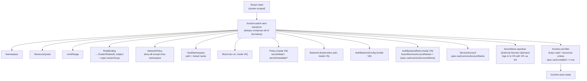

# `Tenant`

Self-service namespace baseline, with an optional per-tenant Vault secrets space. Defined in [`compositions/tenant/`](../../compositions/tenant/).

```yaml
apiVersion: platform.idplatformkit.io/v1alpha1
kind: Tenant
metadata:
  name: demo-team   # also the namespace name, and the Vault namespace path
spec:
  ownerGroup: demo-team-engineers
  vault:
    enabled: true
    serviceAccountName: demo-app   # the *only* ServiceAccount allowed to use this tenant's Vault access
```

`Tenant` is `scope: Cluster` (unlike `PostgresDatabase`) — it mints a *new* namespace, so it can't itself live inside one. Every composed namespaced resource therefore gets an explicit `metadata.namespace` patch rather than inheriting the XR's own namespace.

## Architecture



The baseline (`Namespace`, `ResourceQuota`, `LimitRange`, `RoleBinding`, `NetworkPolicy`) is always created. The eight `vault-*` resources are always *composed* by `function-patch-and-transform` but then conditionally kept or dropped by a second pipeline step, `function-cel-filter`, matching every composed resource whose name matches `vault-.*` against one CEL expression: `has(observed.composite.resource.spec.vault) && observed.composite.resource.spec.vault.enabled`. This is what lets one Composition serve both "just a namespace" and "namespace + secrets space" claims — no second Composition, no per-capability XRD.

## Why OpenBao, not Vault

Vault Community Edition gates real **Namespaces** — a genuine per-tenant isolation boundary with its own policies, mounts and auth methods — behind Vault Enterprise. [OpenBao](https://openbao.org/), the Linux Foundation's open-source Vault fork, ships Namespaces free and GA in its community edition. That's the one feature this design actually needs, so the shared server is OpenBao (`platform/openbao-server/`, dev mode) rather than Vault, and `provider-vault` (Terraform-based, Vault-API-compatible, so it talks to OpenBao without modification) is pointed at it.

Each tenant gets its **own** `VaultNamespace`, with its **own** `secret/` kv-v2 `Mount` and `Policy` inside it — not a shared mount with per-tenant path prefixes. This was verified directly, not assumed: a secret written into one tenant's namespace is invisible both from the root namespace and from a second tenant's namespace.

## Accessing a tenant's Vault namespace

`spec.vault.serviceAccountName` names the **one** Kubernetes ServiceAccount (in the tenant's own namespace) allowed to authenticate as that tenant. The Composition creates it (`vault-serviceaccount`) and wires the trust relationship: a Kubernetes auth `Backend`, `AuthBackendConfig` and `AuthBackendRole`, all scoped inside the tenant's own Vault namespace. Run the workloads that need the secrets as that ServiceAccount.

### As Kubernetes Secrets, through External Secrets Operator

The Composition also creates a `SecretStore` named `openbao` in the tenant's namespace (`vault-secretstore`). It points at the tenant's OpenBao namespace (KV v2 mount `secret`) and logs in with the same Kubernetes auth role, as that ServiceAccount. A team gets a Kubernetes `Secret` by declaring an `ExternalSecret` against it:

```yaml
apiVersion: external-secrets.io/v1
kind: ExternalSecret
metadata:
  name: db-credentials
  namespace: demo-team
spec:
  secretStoreRef:
    kind: SecretStore
    name: openbao
  target:
    name: db-credentials
  data:
    - secretKey: password
      remoteRef:
        key: db-credentials
        property: password
```

`make try-tenant` writes `secret/db-credentials` into the `demo-team` OpenBao namespace, applies [`examples/tenant-external-secret.yaml`](../../examples/tenant-external-secret.yaml) and prints the value from the resulting Kubernetes `Secret`. On kind, the `Secret` showed up about 2 seconds after the `ExternalSecret` was applied.

**Isolation, tested.** Teams have `edit` on their namespace, and External Secrets Operator's ClusterRoles aggregate into `edit`, so a team can create its own `SecretStore`. A store created in the `checkout` namespace and pointed at the `payments` OpenBao namespace, logging in as `checkout`'s ServiceAccount, was refused by OpenBao itself:

```
unable to log in with Kubernetes auth: ... Namespace: payments
URL: PUT http://openbao.openbao-system.svc.cluster.local:8200/v1/auth/kubernetes/login
Code: 403
```

The `payments` role only accepts `payments`' own ServiceAccount from the `payments` namespace.

### Directly, from a pod

A pod running as that ServiceAccount can also log in with its own projected token:

```sh
JWT=$(cat /var/run/secrets/kubernetes.io/serviceaccount/token)
curl -s --request POST \
  --header "X-Vault-Namespace: demo-team" \
  --data "{\"role\": \"tenant-access\", \"jwt\": \"$JWT\"}" \
  http://openbao.openbao-system.svc.cluster.local:8200/v1/auth/kubernetes/login
```

Any other ServiceAccount, including a different one in the *same* namespace, gets `"service account name not authorized"`. This was verified with a real pod running as an unbound ServiceAccount, not just inferred from the config.

## A real gotcha: deletion ordering

The six `vault-*` resources are nested inside the tenant's own `VaultNamespace` (`spec.forProvider.namespace: <tenant>` on each). Deleting a Vault namespace already recursively wipes everything inside it — confirmed directly against a live OpenBao server. But if Crossplane also tries to delete a child resource (`Mount`, `Policy`, the auth `Backend`/`AuthBackendConfig`/`AuthBackendRole`) *after* the parent namespace is already gone (e.g. because `spec.vault.enabled` flips to `false`, or the whole `Tenant` is deleted), that call 404s (`"namespace not found"`) — and `provider-vault` doesn't treat that as success, so the resource gets stuck retrying its delete forever.

The fix, applied to all five children (everything except `vault-namespace` itself):

```yaml
spec:
  managementPolicies: ["Observe", "Create", "Update", "LateInitialize"]  # no "Delete"
```

Excluding `Delete` means Crossplane removes the Kubernetes object without calling the provider's delete on the external resource — correct here specifically because the parent `VaultNamespace`'s own (normal, `Delete`-included) deletion already does that recursively. This was found and fixed by actually toggling `spec.vault.enabled` off and watching a resource get stuck, twice — first with the wrong mechanism (`spec.deletionPolicy: Orphan`, which doesn't exist on this provider's schema), then with the right one.

## Creation order: from 3 minutes to 3 seconds

Crossplane applies every composed resource of a pipeline at once. For a `Tenant`, that's a problem twice over:

1. **Kubernetes**: the `ResourceQuota`, `LimitRange`, `RoleBinding`, `NetworkPolicy` and the six Vault managed resources live *inside* the tenant's namespace, which doesn't exist yet on the first pass. Each fails with `namespaces "<tenant>" not found`, and the XR backs off before retrying. On kind this first phase took about 90 seconds.
2. **OpenBao**: the mount, policy and Kubernetes auth resources live inside the tenant's OpenBao namespace. When they're created before it, OpenBao answers `404 namespace not found`, and provider-vault backs off again.

A Tenant with the Vault add-on took about **3 minutes** to become `Ready` (183s measured). That's longer than the 180s `make try-tenant` waits, which is why the e2e `kind` job failed intermittently (#11).

The last pipeline step, `function-sequencer`, now creates resources in dependency order: namespace → in-namespace resources and the `VaultNamespace` → mount, policy and auth backend → auth config and role. With `resetCompositeReadiness`, the Tenant can't report `Ready` while some resources are still held back. Measured on kind afterwards: Tenants with the Vault add-on were `Ready` in **2 to 3 seconds** over three consecutive runs. A Tenant without it took 2 seconds. In OpenBao, the namespace, policy and auth role were all there.

The `SecretStore` comes last: it waits for the auth role and config, the policy, the mount and the ServiceAccount. External Secrets Operator validates a store against OpenBao as soon as it exists, so creating it early only produces failures. **Gotcha:** a first version listed those prerequisites as one group of alternatives in first position, `(vault-k8s-auth-config|vault-k8s-auth-role|...)`, and the store was **not** held back. It was created before the role and failed validation three times (`InvalidProviderConfig`), and the Tenant took 67 seconds to become `Ready`. With one rule per prerequisite, the store was created in the same second its role became `Ready`, it validated first time, and the Tenant was `Ready` in 4 seconds.

**Wrong first attempt: deletion sequencing.** `function-sequencer` can also order deletion, by creating `Usage`/`ClusterUsage` objects. For a cluster-scoped XR like `Tenant`, v0.6.0 generates `ClusterUsage`s whose `spec.by` has no namespace, so they can never be released:

```
cannot get using: an empty namespace may not be set when a resource name is provided
```

Tenant deletion hung forever, which is worse than without it. This is a known upstream bug ([function-sequencer#114](https://github.com/crossplane-contrib/function-sequencer/issues/114)), so only creation sequencing is enabled.

**Known issue: deleting a Tenant right after creating it can hang** ([#14](https://github.com/idPlatformKit/Orchestrator/issues/14)). The Kubernetes namespace starts terminating while the `VaultNamespace` inside it still needs to create its `ProviderConfigUsage`, which a terminating namespace refuses. It didn't come from creation sequencing: on kind, Tenants deleted 150 seconds after `Ready` went away in 6 to 7 seconds, both with and without it. Tenants deleted about 3 seconds after `Ready` hung every time. Faster creation does make that window easier to hit.

## Try it

```sh
make local-up
make try-tenant    # applies examples/tenant.yaml (vault.enabled: true), shows what got created
```

Toggle `spec.vault.enabled` on an existing `Tenant` claim and re-apply to see the six `vault-*` resources get created or fully torn down (confirmed both in Kubernetes and directly on the OpenBao server) while the namespace baseline stays untouched.
