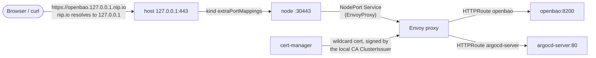

# HTTPS entry point (Gateway API, cert-manager, local CA)

Every platform UI on the kind cluster is reachable over HTTPS, on a stable hostname, with a certificate your machine trusts. No port-forwards.

| URL | What | Flow |
|---|---|---|
| `https://openbao.127.0.0.1.nip.io` | OpenBao API and UI (`/ui`) | both |
| `https://argocd.127.0.0.1.nip.io` | Argo CD UI and API | GitOps only |

Plain HTTP on port 80 answers with a `301` to the HTTPS URL.

It's the foundation the next milestones build on: SSO with Dex (M5) needs HTTPS issuer and callback URLs, PR previews (M8) need per-preview hostnames, and the portal's admin panel needs stable links to each UI.

## Quick start

```sh
make local-up            # or make local-up-gitops
make local-ca-trust      # once per machine, asks for sudo
make try-gateway         # checks the redirect, the certificate and each route
```

`make local-up` generates the local CA the first time (`.local-ca/`, git-ignored) and reuses it afterwards, so `make local-ca-trust` is needed **once per machine, not once per cluster**. Firefox uses its own certificate store: import `.local-ca/ca.crt` there by hand. To rotate the CA, run `make local-ca-untrust`, delete `.local-ca/`, then `make local-up` and `make local-ca-trust` again.

`make try-gateway` doesn't depend on the trust store: it checks the certificate against `.local-ca/ca.crt` explicitly, which is also how CI runs it.

## How it works



| Piece | Where | Role |
|---|---|---|
| kind port mappings | `local/kind-config.yaml` | Host `127.0.0.1:80/443` → node ports `30080/30443`. Bound to localhost only |
| Envoy Gateway v1.9.3 | `platform/envoy-gateway/values.yaml` | Gateway API implementation. Its chart also installs the Gateway API CRDs |
| `EnvoyProxy` `kind-nodeport` | `platform/gateway/envoyproxy.yaml` | kind has no load balancer: the Envoy Service is a `NodePort` with fixed ports `30080/30443` |
| `GatewayClass` `envoy`, `Gateway` `platform` | `platform/gateway/` | One Gateway for the platform, listeners on `*.127.0.0.1.nip.io`: `http` (redirect only) and `https` (TLS terminated, routes accepted from every namespace) |
| cert-manager v1.21.3 | `platform/cert-manager/values.yaml` | Issues and renews the certificates |
| `ClusterIssuer` `idplatformkit-local-ca` | `platform/gateway/cluster-issuer.yaml` | A CA issuer reading the local CA's key pair from the `idplatformkit-local-ca` Secret |
| `Certificate` `platform-tls` | `platform/gateway/certificate.yaml` | One wildcard certificate, `*.127.0.0.1.nip.io` |
| Routes | `platform/gateway/openbao-route.yaml`, `bootstrap/argocd/route/` | One `HTTPRoute` per UI, in the service's own namespace |

`platform/gateway/` is a kustomize base shared by both flows (`make gateway-apply` and the `gateway` Argo CD Application). The Argo CD route lives in `bootstrap/` because Argo CD only exists in the GitOps flow. TLS ends at the Gateway, so `argocd-server` runs with `server.insecure: true` and serves plain HTTP inside the cluster.

### Why these choices

- **Gateway API, not Ingress.** It's the Kubernetes standard for traffic routing, and ingress-nginx was retired in March 2026.
- **Envoy Gateway over Traefik.** It's built for Gateway API only, with no proprietary annotations for the basics. It's also the natural base for the AI gateway planned in M13 ([#39](https://github.com/idPlatformKit/Orchestrator/issues/39)).
- **nip.io and a local CA over a real domain.** No domain, DNS account or token needed, so anyone who clones the repo gets the same URLs. The cost is trusting a local CA once.
- **The CA is generated on the host, not in the cluster.** A self-signed CA created by cert-manager would change with every cluster, and you would have to trust a new one each time. Here `make local-ca` creates it once with `openssl`, and `make local-ca-secret` loads it as a bootstrap Secret, like the Postgres and OpenBao credentials: never in Git.

## What was actually observed, gotchas included

Verified on fresh kind clusters (kind v0.32.0, OrbStack on macOS) with both `make local-up` and `make local-up-gitops`, then with `make try-gateway`, `make try-tenant` and `make try-postgres-database`:

- `http://openbao.127.0.0.1.nip.io` → `301 https://openbao.127.0.0.1.nip.io/`.
- `https://openbao.127.0.0.1.nip.io/v1/sys/health` answers, the certificate verifies against the local CA only (`curl --cacert .local-ca/ca.crt`), issuer `CN=IdPlatformKit local CA`, SAN `*.127.0.0.1.nip.io`. The OpenBao UI answers `200` on `/ui/`.
- `https://argocd.127.0.0.1.nip.io`: the UI answers `200`, and logging in with the admin password through `/api/v1/session` then listing applications works.
- The Envoy Service came up as `NodePort` with `80:30080` and `443:30443`: the strategic merge patch in the `EnvoyProxy` matches the Service ports by their `port`.

**macOS rejects TLS certificates without `serverAuth`.** Certificates issued since 2019 need the `serverAuth` extended key usage, which cert-manager doesn't add by default. `platform-tls` lists `server auth` in `usages`.

**`envoy-gateway` is briefly `Degraded` on a fresh cluster.** In the GitOps flow, right after the chart's `certgen` hook Job completes, the `envoy-gateway` Application reports `Degraded` with no individual resource reported unhealthy. It lasted about 3.5 minutes on the first run and 8 seconds on a later one. The exact cause wasn't pinned down. It matters because a sync wave fails when one of its Applications is `Degraded`: on the first run, the root app `platform` failed its wave five times in a row, gave up on that revision, and never created `compositions` and `instances`. The root app now has an explicit `retry` (`bootstrap/root-app.yaml`), as the `providers` app already had for its `ClusterProviderConfig`s. On the later run, the root app synced on its first attempt, so that retry wasn't exercised there.

**Not done yet: in-cluster callers.** Inside the cluster, `*.127.0.0.1.nip.io` resolves to the caller's own loopback (the pod, or the node for host-network components such as the API server), not to the Gateway. Nothing needs it yet. SSO (M5) will: the API server and Argo CD will have to reach Dex by its public URL, which needs a CoreDNS rewrite to the Envoy Service and the local CA trusted in those components.

## Limits

- The Gateway accepts routes from every namespace. Fine on a single-user kind cluster. Once tenants can publish their own routes, the `https` listener should only accept platform namespaces, and tenants should get their own listener or Gateway.
- Single-replica Envoy Gateway and cert-manager, default settings. Like the rest of the platform services, a reference setup for kind, not a production one.
- The host ports 80 and 443 must be free when the cluster is created.
