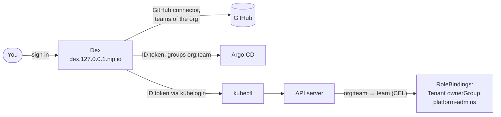

# Single sign-on (Dex)

People sign in to the platform with GitHub, and **their teams in the installation's org are their groups everywhere**. Adding someone to a team gives them access; removing them takes it away. Nobody shares an admin token.

| Where | How you sign in | What your teams give you |
|---|---|---|
| Portal | GitHub (the portal's own OAuth App) | Ownership of the tenants and databases your teams own |
| Argo CD (`https://argocd.127.0.0.1.nip.io`) | "Log in via GitHub", through Dex | Read for every org member, admin for `platform-admins` |
| kubectl (`make kubeconfig-sso`) | Through Dex, with kubelogin | `edit` on the namespaces of your teams' tenants, `cluster-admin` for `platform-admins` |
| OpenBao (`https://openbao.127.0.0.1.nip.io/ui`) | OIDC, through Dex, with a role | Role `tenant-<name>`: read and write the secrets of a tenant your team owns. Role `admin` (the default): everything, for `platform-admins` |

The portal keeps its own GitHub sign-in: it needs the user's GitHub token to open pull requests in their name, which Dex doesn't provide.

## Setup

`make setup` takes care of it ([install.md](install.md)):

- a second **OAuth App** in the org, for Dex (an OAuth App has a single callback URL, and Dex's isn't the portal's): homepage `https://dex.127.0.0.1.nip.io`, callback `https://dex.127.0.0.1.nip.io/callback`;
- the **`platform-admins`** team, created through the GitHub API with you in it, if the org doesn't have one.

kubectl as yourself also needs [kubelogin](https://github.com/int128/kubelogin) (`brew install kubelogin`):

```sh
make kubeconfig-sso                       # adds the idpk-sso context
kubectl --context idpk-sso auth whoami    # opens the browser the first time
```

Your usual `kind-idplatformkit-local` context stays the cluster's admin certificate, for the platform's own operations. OpenBao's dev root token, `root-local-dev`, still works too: both are break-glass paths for now (#29).

## How it fits together



- **Dex** (`platform/dex/values.yaml`) is the OIDC issuer. Its GitHub connector only reads the installation's org, and sends its teams by slug as groups: `idpk-test:team-a`. Its config is the same for every installation: Dex expands environment variables, and the org, its OAuth App and the client secrets come from the `dex-secrets` bootstrap Secret (`make dex-secret`). In-memory storage: a Dex restart signs everyone out.
- **The API server** trusts Dex through a structured authentication configuration (`local/authentication-config.yaml`, rendered with the local CA by `make kind-up`). A CEL expression keeps the team slug: `idpk-test:team-a` becomes `team-a`, which is what a Tenant's `ownerGroup` and the `platform-admins` binding (`platform/access/`) name. Neither names the org, so they work for every installation. Usernames are `github:<login>`.
- **Argo CD** uses Dex as its OIDC provider (`local/argocd-sso-values.yaml`, rendered with the org and the local CA by `make argocd-install`). It gets the groups as is: its RBAC names `<org>:platform-admins`.

## OpenBao

OpenBao's `oidc` auth method, in its root namespace, signs people in through Dex (`platform/openbao-sso/`, managed with provider-vault like the tenants' OpenBao resources). Choose a role when signing in:

- **`admin`**, the default role: `platform-admins` only, policy `platform-admin` (every path, every namespace).
- **`tenant-<name>`**: created by each `Tenant` with OpenBao enabled, for its `ownerGroup` only. Its policy grants `<name>/secret/*` and nothing else. In the UI, sign in with that role, then switch to the tenant's namespace (top left) to see its secrets. From the CLI: `bao login -method=oidc -path=oidc role=tenant-<name>`.

Two choices keep this the same for every installation:

- **The roles match teams with a glob**, `*:team-a`, rather than `<org>:team-a`. Dex only sends the installation's org's teams, so the glob can't match another org, and the Tenant composition doesn't need to know the org. A first design passed the org to the composition through a Crossplane `EnvironmentConfig`; the glob made it unnecessary.
- **The team's policy lives in OpenBao's root namespace**, where the auth method is, and reaches the tenant's namespace through its path prefix. Checked by hand first: a root-namespace token with a policy on `demo/secret/*` read `demo`'s secret, and was refused with `403` in another tenant's namespace and on `demo`'s policies.

OpenBao reaches Dex at its public URL through the platform Gateway, and trusts the local CA through `SSL_CERT_FILE`, from the `idpk-local-ca` ConfigMap (the certificate only) created by `make local-ca-secret`.

## Reaching Dex from inside the cluster

Dex's issuer is `https://dex.127.0.0.1.nip.io`, the URL your browser uses. Argo CD and the API server must reach it at that same URL, or the tokens' issuer won't match. But `*.127.0.0.1.nip.io` resolves to `127.0.0.1`: inside a pod, the pod itself; on the node, where the API server runs, the node itself.

So, inside the cluster, these names resolve to the platform Gateway instead, which serves them with the same certificate as for the browser:

- the Gateway's Envoy Service has a **fixed ClusterIP**, `10.96.0.80` (`platform/gateway/envoyproxy.yaml`), in the Service subnet set explicitly in `local/kind-config.yaml`;
- **pods**: CoreDNS answers every `*.127.0.0.1.nip.io` name with it (`local/coredns.yaml`, a `template` block);
- **the API server**, on the node's network, doesn't use CoreDNS: a kubeadm patch adds a `hostAliases` entry to its static Pod (`local/kubeadm-patches/`). The kubelet honours `hostAliases` on `hostNetwork` Pods: checked by hand first, with the entry showing up in the API server's `/etc/hosts`.

Each caller still has to trust the local CA: inlined in the API server's configuration and in Argo CD's `rootCA`.

## What was actually observed

On kind (Kubernetes 1.36), with the test org `idpk-test` and a fresh `make up` (4.5 minutes):

- From a pod, `dex.127.0.0.1.nip.io` resolved to `10.96.0.80` and `https://openbao.127.0.0.1.nip.io` answered `200`; `github.com` still resolved normally.
- From the node's network, a request to the Gateway's ClusterIP with the platform hostname as SNI verified against the local CA and answered `200`.
- Argo CD: "Log in via GitHub" went through Dex and GitHub; a member of `platform-admins` was admin.
- kubectl: `kubectl --context idpk-sso auth whoami` returned `github:antoyavin`, groups `platform-admins`, `team-a`, `system:authenticated`. As that user, `auth can-i delete pods -n kube-system`: `yes` (platform-admins). Impersonating a member of `team-a` only: `create deployments` in the `demo` tenant `yes`, in `kube-system` `no`, `list namespaces` `no`. The Tenant's `RoleBinding` to its `ownerGroup`, there since the first milestone, finally serves a real person.

**First attempt: the CEL expression didn't compile.** `claims.groups.map(...)` was refused at API server start-up, and `kind create cluster` failed waiting for the control plane:

```
invalid authentication configuration: jwt[0].claimMappings.groups.expression: ...
compilation failed: ERROR: <input>:1:28: expression of type 'any' cannot be range ...
```

Claims are untyped. `dyn(claims.groups).map(...)` compiles. To see such errors, `kind create cluster --retain` keeps the node so the API server's logs can be read (`crictl logs`).

**OpenBao, tested by signing in.** In the UI, OIDC with the default role: a token `oidc-antoyavin` with `platform-admin`. Then with role `tenant-demo`: a token with `tenant-demo` only; in the `demo` namespace the UI showed `secret/db-credentials`, and reading elsewhere was refused.

**The OpenBao UI stuck on its logo, in Firefox only.** After several re-creations of the cluster, the UI never got past its loading screen. Headless Chromium and Firefox loaded it fine, and its API answered; a private window worked too. The UI keeps its last token and namespace in the browser's local storage, from an OpenBao instance that no longer exists. Clearing the site's data fixes it.

## Limits

- Grafana doesn't use Dex yet: it comes with per-tenant observability (#25).
- Dex stores sessions in memory: after a restart, sign in again.
- The kind cluster's admin certificate (`kind-idplatformkit-local`) still works: it's the break-glass path for now. Dedicated non-human and emergency identities are [#29](https://github.com/idPlatformKit/Orchestrator/issues/29).
- Argo CD's local `admin` account is still enabled, with its generated password.
